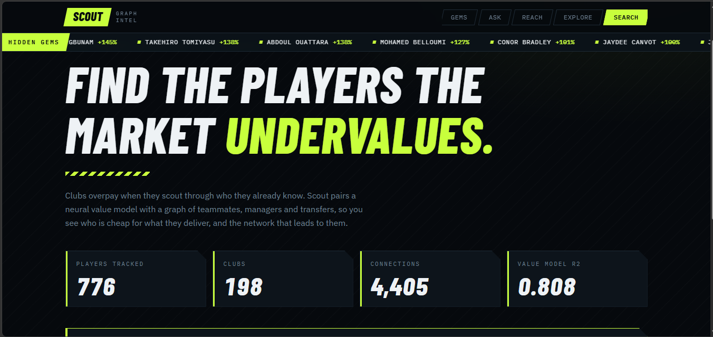
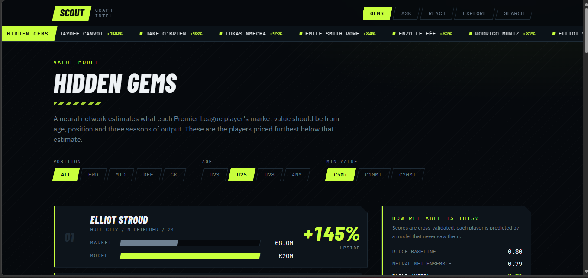
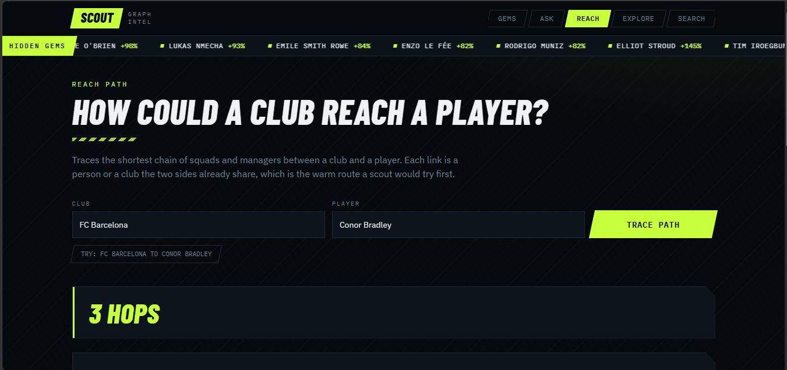
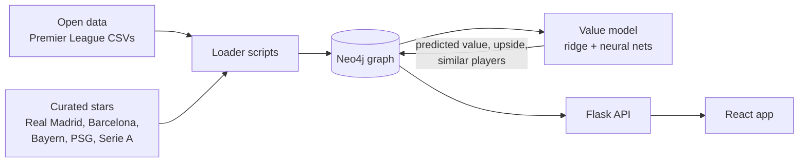
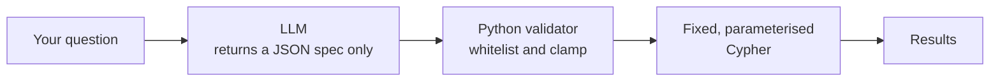
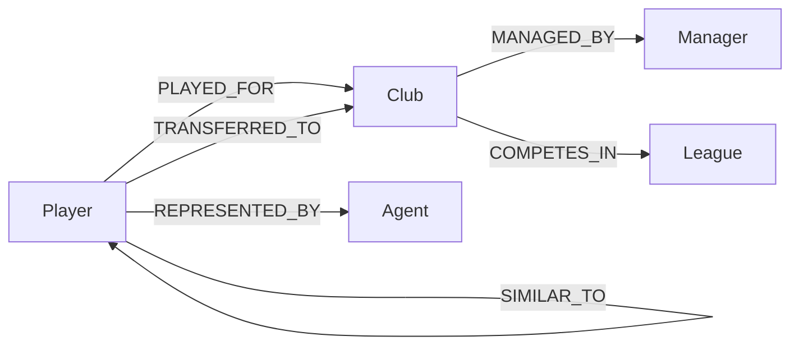

# SCOUT

### Find the football players the market undervalues - and the people who lead to them.

**Live site:** https://scout-frontend-pblr.onrender.com

> The backend runs on Render's free tier, so the very first request after a quiet period can take 30-50 seconds while it wakes up. After that it is fast.

**In simple words:** Scout is a website that helps a football club decide which players to sign. It does two jobs. First, it spots players who cost less than they should: a computer model learns what a player is worth from his age, position and recent performances, and Scout shows who is priced below that. Second, it shows how the club could reach that player, through people they already share, such as old teammates and managers. You can even just type a question like "young left-backs under 20 million" and get an answer.

<!--
SCREENSHOTS: save your images in a Screenshots folder, then remove the comment markers around this block:




-->

---

## The idea in 30 seconds

Football clubs spend enormous amounts of money on transfers, and two things tend to go wrong:

1. **Price follows reputation, not output.** A famous name costs more than a player who delivers the same on the pitch.
2. **Scouting follows who you already know.** Players tend to get noticed through the same few networks of teammates, managers and agents.

Scout goes after both problems at once:

| The question | How Scout answers it |
|---|---|
| *"Who is cheap for what they deliver?"* | A **neural value model** estimates what each player *should* cost from age, position and three seasons of output, then ranks the gap. |
| *"How could we actually reach them?"* | A **graph of players, clubs and managers** traces the shortest chain of squads and managers between your club and the player. |
| *"I just want to ask in plain English."* | An **assistant** turns a normal sentence into a safe database query. |

**New to football?** Four words are enough: a **club** is a team, a **transfer** is a player moving between clubs, an **agent** represents a player and negotiates his moves, and a **manager** is the head coach.

---

## What you can do

| Page | The question it answers | Try this |
|---|---|---|
| **GEMS** | Which Premier League players are priced furthest below what the model expects? | Filter by position, age and minimum value. Each row shows a MARKET vs MODEL duel bar. |
| **ASK** | Can I just type what I want? | "Young left-backs priced under 20 million" |
| **REACH** | How could club X get to player Y? | FC Barcelona to Conor Bradley, drawn as a route across a football pitch |
| **EXPLORE** | Who is connected to a star? How many steps apart are two players? Who already knows a manager's style? | Scouting chain, shortest path, manager lineage |
| **SEARCH** | Tell me about one player or club. | Player dossiers (market value vs model, teammates network, "players like this") and club squads |

A scrolling **Hidden gems ticker** runs under the header on every page, pulled live from the model.

---

## How it works



The graph holds roughly **776 players, 198 clubs and 4,400 relationships**. The model's results are written back onto the players, so every page reads from one place.

---

## The value model - and its honest limits

For every Premier League player with enough minutes, the model predicts a market value from **age, position and three seasons of output**. The gap between that estimate and the real price is the **upside**.

Scores below are 5-fold cross-validated, meaning every player is predicted by a model that never saw him (385 players).

| Model | R-squared (on log value) |
|---|---|
| Ridge regression (linear baseline) | 0.795 |
| Neural network (ensemble of 5 MLPs) | 0.788 |
| **Blend of both (used in the app)** | **0.808** |

What this does **not** claim, stated plainly:

- **The neural network alone does not beat the simple linear baseline** at this data size. The blend is only slightly better. The network earns its place another way: its learned 16-dimensional player embedding powers the **"players like X"** search.
- **Upside includes a club-size effect.** Players at newly promoted clubs look cheaper for the same output, so some "gems" are partly a club-size signal.
- **Premier League only.** The curated stars from Real Madrid, Barcelona, Bayern, PSG and Serie A have approximate market values and no stats, so the model gives them no estimate.
- **Agent links are marked "publicly reported, not verified".** Only 7 are included.
- **It is a starting point for scouting, not a verdict.**

---

## Ask the graph: using an LLM safely

The assistant uses a language model (`openai/gpt-oss-120b` via Groq), but the model **never writes database queries**.



1. The model returns only a small JSON description: an intent (`players`, `similar`, `reach` or `unsupported`) and a few filters.
2. Python checks every field against a whitelist and clamps every number. Nothing from the model reaches the database unchecked.
3. The checked spec is turned into a **parameterised** query written by hand.
4. The page shows a **READ AS** strip so you can see exactly how your question was understood.
5. Requests are limited to 12 per minute per IP.

Questions it understands:

| You type | It runs |
|---|---|
| "Undervalued midfielders under 23" | a filtered, upside-sorted player list |
| "Players like Erling Haaland" | nearest neighbours in the neural embedding |
| "How could FC Barcelona reach Conor Bradley?" | a shortest-path trace, drawn on the pitch map |

---

## Why a graph database?

Scout's signature question: *"Find young players who used to play alongside Player X and share an agent with someone who already moved to our target club."*

That is three hops of connection. In a normal table-based database each hop is another join, so the query gets long, slow and hard to read. In a graph database, people and clubs are **nodes** and their relationships are stored as direct **connections**, so the query reads almost like the sentence:

```cypher
MATCH (source:Player {name: $player_name})-[:PLAYED_FOR]->(:Club)<-[:PLAYED_FOR]-(candidate:Player)
WHERE candidate.name <> $player_name AND candidate.birth_year >= $min_birth_year
MATCH (candidate)-[:REPRESENTED_BY]->(agent:Agent)
MATCH (agent)<-[:REPRESENTED_BY]-(:Player)-[:TRANSFERRED_TO]->(:Club {name: $target_club})
RETURN DISTINCT candidate.name, candidate.position, candidate.birth_year, agent.name
```

The same idea powers the Reach page: one `shortestPath` call finds the shortest chain of squads and managers between any club and any player.

---

## Data model



| Node | Key properties |
|---|---|
| `Player` | `name`, `position`, `nationality`, `birth_year`, `market_value`, plus model fields `predicted_value`, `upside_pct`, `model_minutes` |
| `Club` | `name`, `country` |
| `Agent` | `name`, `agency` |
| `Manager` | `name`, `nationality` |
| `League` | `name`, `country` |
| `ModelInfo` | the model card shown on the Gems page |

`PLAYED_FOR` records a playing stint (years, appearances, goals). `TRANSFERRED_TO` records the move itself (year, fee, type). `SIMILAR_TO` links come from the neural embedding and carry a similarity `score`.

---

## API

| Area | Endpoints |
|---|---|
| Health | `GET /api/health` |
| Players | `GET /api/players/search`, `/api/players/<name>`, `/api/players/<name>/teammates`, `/api/players/<name>/similar` |
| Clubs | `GET /api/clubs/search`, `/api/clubs/<club>/squad`, `/api/clubs/<club>/agent-clusters` |
| Network | `GET /api/network/scouting-chain`, `/shortest-path`, `/manager-lineage`, `/stats`, `/graph-explore` |
| Insights | `GET /api/insights/hidden-gems`, `/model-card`, `/reach` |
| Assistant | `POST /api/assistant/query`, `GET /api/assistant/examples` |

Every query goes through the official Neo4j Python driver with parameters. There is no string-built Cypher anywhere.

---

## Run it yourself

You need Python 3, Node 18 or newer, and a free [Neo4j AuraDB](https://neo4j.com/cloud/aura-free/) instance. These steps are for Windows PowerShell.

### 1. Backend

```powershell
cd backend
pip install -r requirements.txt
```

Create `backend\.env` (never commit this file):

```
COGNODB_URI=neo4j+s://<your-instance-id>.databases.neo4j.io
COGNODB_USERNAME=<your-instance-id>
COGNODB_PASSWORD=<your-password>
GROQ_API_KEY=<your-groq-key>
```

The variable names still say COGNODB for historical reasons; they work with any Neo4j instance. `GROQ_API_KEY` is only needed for the Ask page (optionally set `GROQ_MODEL` to change the model).

### 2. Load the data

The Premier League data is not stored in this repo. Clone [oladeeayo/pl-catalogue](https://github.com/oladeeayo/pl-catalogue) and copy the CSV files that `load_pl_data.py` reads into `backend\data`.

Then run the scripts **in this order**, from the `backend` folder:

| Step | Script | What it does |
|---|---|---|
| 1 | `scripts\load_pl_data.py` | Wipes the database, then loads 672 Premier League players, transfers and career stints |
| 2 | `scripts\load_stars.py` | Adds 56 stars from Real Madrid, Barcelona, Bayern and PSG, plus 7 reported agent links |
| 3 | `scripts\load_extras.py` | Adds deeper Barcelona squad data and 25 managers |
| 4 | `scripts\load_serie_a.py` | Adds 40 Serie A stars and 5 coaches |
| 5 | `scripts\train_value_model.py` | Trains the model and writes predictions, upside, similar-player links and the model card |

```powershell
py scripts\load_pl_data.py
py scripts\load_stars.py
py scripts\load_extras.py
py scripts\load_serie_a.py
py scripts\train_value_model.py
py app.py
```

The API starts on http://localhost:5000. Any "Failed to write data to connection" lines when a script exits are harmless.

### 3. Frontend

In a second terminal:

```powershell
cd frontend
npm install
```

Create `frontend\.env` with `VITE_API_URL=http://localhost:5000`, then:

```powershell
npm run dev
```

Open the URL Vite prints (use `npm run dev -- --port 3000 --host 127.0.0.1` if port 5173 is blocked on your machine). The footer should read **GRAPH CONNECTED**.

---

## Deployment (Render)

- **Backend:** Web Service, root directory `backend`, build `pip install -r requirements.txt`, start `gunicorn app:app`. Environment variables: `COGNODB_URI`, `COGNODB_USERNAME`, `COGNODB_PASSWORD`, `GROQ_API_KEY`.
- **Frontend:** Static Site, root directory `frontend`, build `npm install && npm run build`, publish directory `dist`, with `VITE_API_URL` set to the backend URL.

Free Neo4j Aura instances can be paused when idle. If the footer ever shows **GRAPH OFFLINE**, resume the instance from the Aura console.

---

## Project structure

```
scout/
|-- backend/
|   |-- app.py                   Flask entry point and health check
|   |-- db.py                    Neo4j connection with retry handling
|   |-- routes/
|   |   |-- players.py           search, detail, teammates, similar
|   |   |-- clubs.py             search, squad, agent clusters
|   |   |-- network.py           scouting chain, shortest path, manager lineage
|   |   |-- insights.py          hidden gems, model card, reach
|   |   `-- assistant.py         LLM question -> validated spec -> Cypher
|   |-- scripts/                 data pipeline and model training (see above)
|   `-- data/                    local CSVs (gitignored)
`-- frontend/
    `-- src/
        |-- pages/               Landing, Gems, Ask, Reach, Explore, PlayerDetail, ClubDetail
        |-- components/          ui.jsx (tiles, duel bars, count-up), Ticker, PitchMap, NetworkGraph
        `-- api.js
```

---

## Engineering notes

- **Safe by construction.** The language model can only choose from a fixed menu of filters. Everything is whitelisted, clamped and parameterised before it touches the database.
- **Honest numbers everywhere.** The model card, the footer attribution and the "not verified" labels are in the interface, not buried in this file.
- **Accessible motion.** Count-ups, the ticker, the staggered reveals and the pitch pulse all respect `prefers-reduced-motion`.
- **Built to be re-run.** The loaders use `MERGE`, so they can be re-run safely, and secrets live only in `.env` files and Render's environment settings.
- **Connection resilience.** Some networks (IPv6-only or NAT64 setups, common in parts of India) cause occasional TLS handshake failures right after a fresh connection. `db.py` retries briefly on both verification and queries to absorb this without hiding a truly unreachable database.

---

## Data and attribution

- **Premier League 2026/27 players, transfers and career stints:** [oladeeayo/pl-catalogue](https://github.com/oladeeayo/pl-catalogue). Used under its terms: **non-commercial use, attribution required**. Scout is a portfolio project and is not for commercial use.
- **Stars from other leagues** (Real Madrid, Barcelona, Bayern, PSG, Serie A) and the managers and coaches were compiled by hand. Their market values are **approximate** and are labelled that way in the app.
- **Agent links** are publicly reported and **not verified**.

---

Built by Muhammad Hafiz - [github.com/Hafiz12112003](https://github.com/Hafiz12112003)
